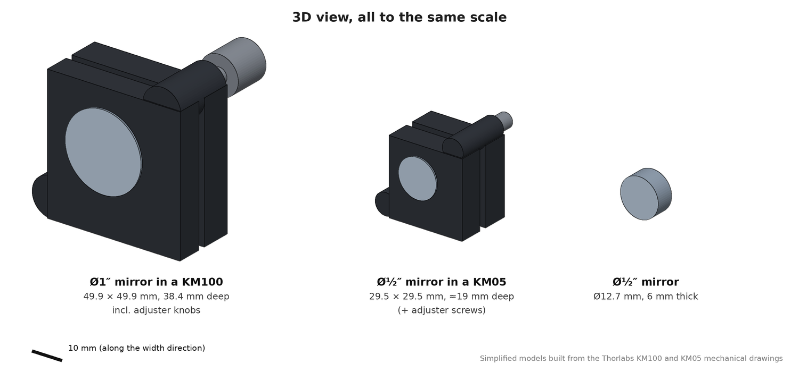
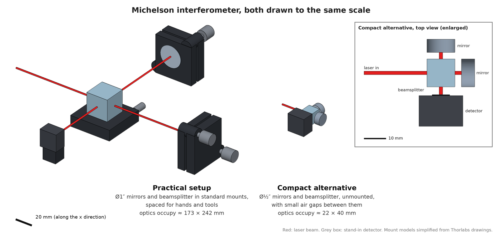
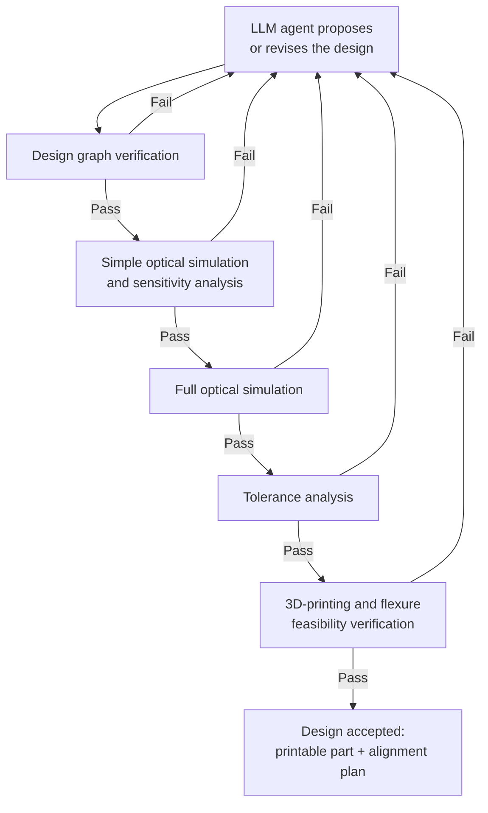

Degree level: PhD

# Project proposal

## 1. The problem and goal

(Explain the problem you want to solve and why it matters. Describe what you
want to improve, how you will measure improvement, and which limits or
requirements must be respected. A short example can help someone outside your
field understand the problem.)

**The problem and goal in my project:**

### The problems

Tabletop optical setups (beam expanders, interferometers, frequency-conversion
stages) are built in a way that wastes space, time and parts:

1. **They are far larger than they need to be.** Every lens and mirror sits in
   a commercial post-and-mount holder bolted to an optical table, spaced so
   that a researcher's hands and tools can reach every knob. The holders and
   finger room, not the optics, set the size: a setup is often 5–10 times
   larger than the same commercially available optics would allow. Large
   setups drift more (longer lever arms, more mounts, more thermal paths),
   occupy expensive table area, and are hard to move or replicate
   (Figure 1).

   

   *Figure 1. To scale: a bare ؽ″ mirror is a 12.7 mm disc, 6 mm thick. In a
   standard ؽ″ kinematic mount it occupies a 29.5 mm square about 19 mm deep;
   a standard Ø1″ kinematic mount is 49.9 mm across and 38.4 mm deep. By
   volume, the Ø1″ mount is more than 100 times the ؽ″ mirror, before adding
   the post, post holder and finger room around it. Simplified models built
   from Thorlabs mechanical drawings.*

2. **They are not fully simulated before parts are placed.** A complete
   calculation (beam propagation through every real catalog part, wave
   effects where coherence matters, sensitivity to every mount error) would
   take a researcher an unrealistic amount of time. Instead, designs rest on
   back-of-envelope estimates, simplified models and untested assumptions.
   This leads to non-optimal choices of optics and positions that only show
   up on the table, followed by redesign, re-ordering and replacement of
   parts down the road.
3. **Design is a slow manual loop.** Choose a layout, pick parts, place them,
   check the beam, check the sensitivity, repeat. A single mistake (a beam
   clipping a lens edge, an interferometer arm that does not close, a layout
   that falls out of spec when a mount shifts by a few micrometres) often
   shows up only after the parts are bought and aligned.

For example, "expand a 1 mm 1064 nm beam to 5 mm, collimated, using stock
Thorlabs lenses, robust to ±50 µm / ±0.5 mrad mount errors" is normally built
on a breadboard tens of centimetres long after a rough calculation, although
the lenses themselves would fit in a few centimetres.

### The proposed solution and goal

An LLM agent that turns such a target specification into a finished,
buildable design, in two equally important parts:

- **Design planning, fully simulated.** The agent chooses the layout and real
  catalog parts and places them, and every candidate is checked by a full
  simulation (beam propagation, wave effects, sensitivity to mount errors)
  instead of rough estimates. The agent will work in a closed loop (propose,
  validate, simulate, check tolerances, revise; see Section 3).
- **Compact physical realization: 3D printing and flexures.** Because the
  setup is now carefully designed and simulated before anything is built, the
  freedom that large mounts and holders provide (room to move, swap and
  re-adjust every part by hand) is no longer needed, and the optics can be
  placed in a compact 3D-printed setup. Instead of posts and commercial
  mounts, the design becomes a single **3D-printed monolithic baseplate**:
  the optics drop into slots printed at their exact simulated positions,
  and only the few degrees of freedom that truly need
  adjustment get **built-in flexure stages** (printed suspended platforms
  moved by a screw), chosen from the tolerance analysis. Everything else is
  fixed by the print. The result is a part as small as the optics allow,
  reproducible, and delivered with an alignment plan that says which screw
  to turn, by how much, and in what order. In the example above, the same
  lenses would sit in a few centimetres of printed plastic with one flexure
  for the focus; Figure 2 shows the same effect for an interferometer.

  

  *Figure 2. A Michelson interferometer (beamsplitter cube, two mirrors and a
  stand-in detector), both versions drawn to the same scale. Left, the
  practical setup: Ø1″ optics, each in a standard mount, spaced to leave room
  for hands and tools, occupying about 17.3 × 24.2 cm. Right, a compact
  alternative with unmounted ؽ″ optics (inset: enlarged top view), about
  2.2 × 4.0 cm: roughly 50 times less table area.*

As the research question, I will measure **where an LLM in a design loop
(proposing, getting simulation and verification feedback, and revising)
actually adds value** in this kind of physical design, compared both to the
same LLM designing without the loop and to classical search and optimization.

I will measure improvement on a benchmark of ~15 design tasks of increasing
difficulty (telescopes, fiber coupling, Mach–Zehnder and Michelson
interferometers, second-harmonic generation stages):

- **Success rate:** the design meets every target metric with no
  validation errors and no unresolved simulator warnings.
- **Robustness:** Monte Carlo yield (fraction of perturbed builds still in
  spec) at the stated mechanical tolerances.
- **Compactness:** footprint and volume of the printed monolith compared with
  a conventional post-and-mount build of the same parts, and the number of
  adjustable degrees of freedom needed (fewer is better).
- **Buildability:** every flexure passes the mechanics check (enough travel
  and resolution, low parasitic motion); for a few tasks, the monolith is
  printed and aligned in the lab, and the measured beam is compared with the
  simulation.
- **Cost:** number of simulator calls, LLM tokens and wall-clock time per
  solved task.
- **Baselines:** the loop is compared against (1) a vanilla LLM, with no
  simulator, tools or feedback, asked to design a setup for the same task,
  its answer then scored by the simulator: this isolates what the loop
  itself adds; (2) random/grid search and a numeric optimizer (CMA-ES or
  Bayesian optimization) over a fixed topology, with the same simulator
  feedback but no LLM; and (3) a hybrid where the LLM in the loop picks the
  topology and parts and the optimizer tunes distances.

Limits that must be respected: only real, purchasable catalog parts; physical
validity (no clipping; beams that are split and later recombined, as in an
interferometer, actually meet again at the same point; consistent angles of
incidence); a monolith that fits a 3D-printer bed and leaves enough material
around each slot and flexure to be printable and stiff; and honesty about the
simulator: any physical effect needed for a full description of a task that
the simulator does not model must be stated clearly wherever it is relevant,
and tasks are scored only on what is actually simulated.

## 2. The simulator

(Describe a program or model that could simulate your system and calculate what
happens under different conditions. Explain what inputs it takes and what
results it produces. State whether it can run on your computer and accept inputs
in a text file, such as JSON or YAML. If you have not chosen a simulator yet,
name an option you want to explore and explain what you need to check.)

**The simulator in my project:**

AutoOptics, a Python package I have been developing. A setup is written as a
directed graph in a JSON file (optical elements as nodes, beam segments as
edges, with catalog part numbers, distances and deflection angles). The
simulator then runs:

- **Layer 1:** ABCD matrices, Gaussian-beam propagation and Jones polarization
  (beam size, waist position, divergence, polarization at every element).
- **Layer 2:** scalar wave optics (angular spectrum) where coherence matters,
  for example fringe visibility and phase in interferometers.
- **Layer 3 (partial):** crystal optics and phase matching (Δk, coherence
  length) for χ⁽²⁾ crystals through Lightwave Explorer; full nonlinear
  conversion is the open frontier.
- **Tolerance engine:** sensitivity Jacobians and covariance propagation of
  mechanical errors, cross-checked by Monte Carlo, giving a variance budget
  and yield.
- **Validation:** geometric checks (beams that are split and later
  recombined, as in an interferometer, actually meet again at the same point;
  angle-of-incidence consistency; beam obstruction) with error/warning
  severities.
- **Physical realization:** a 3D-printable STEP monolith (PLA) with optic
  slots placed from the same coordinates the simulation used, suspended-
  platform flexure stages for the degrees of freedom that need adjustment, an
  analytical model of each flexure (travel per screw turn, resolution,
  parasitic motion, screw force) with an optional finite-element check, and a
  step-by-step alignment plan.

Outputs are JSON metrics, a markdown report with layout figures, the STEP
files and the alignment plan. It runs on my laptop (Python 3.11, no GPU)
against a local database of 34k Thorlabs products. A large part of the
simulation code is already written, but the AI agent and the loop that
connects it to the simulator do not exist yet. Building them, evaluating them,
and validating the simulation code, is the course project.

## 3. The agent's role

(Explain what the language-model-based agent will decide or change, and how it
will use the simulator's results to choose its next action. If known, list the
variables it may change and their allowed ranges. Explain what you expect the
language model to contribute: could a simple program that tries different
options and picks the best result achieve the same goal? Include one question
you still need to answer.)

**The agent in my project:**

In this course I will build the agent and the design loop it works in: it will
propose a layout, and each check below will either send the design back with
the reason it failed, or pass it on to the next check, until the design is
accepted.

The agent will edit the JSON design graph through a set of tools that I will
define as part of the project (look up a catalog part, add/remove/replace an
element, set a distance or angle, validate, simulate, run tolerance
analysis). It will decide:

- **Topology:** which elements and in what order (e.g. Galilean vs Keplerian
  telescope, one vs two fold mirrors, where to put a waveplate).
- **Parts:** which catalog items to use (focal length, diameter, coating,
  crystal), from ~34k products.
- **Continuous parameters:** element spacings (0–500 mm), fold angles
  (0–90°) and crystal angles, pushing the layout to be as compact as the
  optics allow rather than as roomy as hands require.
- **Adjustability:** which elements get flexure stages and along which axes,
  guided by the tolerance analysis (adjust the least sensitive element that
  can still correct each error), so the printed part needs as few knobs as
  possible.

After each change it will read the simulator's metrics, validation errors and
warnings, and the tolerance report (which mount errors dominate the variance
budget), then decide the next edit, and stop only when every metric is in
spec, no errors or warnings remain, and the monolith and its flexures pass the
mechanics checks.

What I expect the LLM in the loop to contribute: the choices a brute-force
search handles badly, and which an LLM without feedback gets wrong. Topology
and part selection are discrete and combinatorial, and they benefit from
domain heuristics (stored in a versioned `skills.md` file the agent reads) and
from understanding *why* a design failed, which only the loop's simulation and
verification feedback can tell it ("the beam clips L2: use a 1-inch lens or
move it closer"). Pure numeric tuning of distances is probably done better and
cheaper by an optimizer, so the agent will be allowed to call one. The
benchmark compares the LLM without the loop, the LLM in the loop,
optimizer-only and the hybrid to test this directly.

Open question: does the agent's ability to update its own heuristics file
across tasks measurably improve success and cost on unseen tasks, or does it
only restate textbook rules it already knew?

## Explain your project to someone outside your field

(Now describe your whole project again, as if you were explaining it to someone
from another field who has no background in your topic. For example, if you
study chemical engineering, imagine explaining it to a physicist; if you study
aeronautical engineering, imagine explaining it to someone in medicine; if you
study data science, imagine explaining it to a materials engineer. In one or two
short paragraphs, connect all three parts: the problem you want to solve, how
the simulator helps you test ideas, and what the agent will decide or change.
Use everyday language, explain any technical terms you need, and avoid
unexplained abbreviations. Do not simply copy your answers above.)

**My project in simple words:**

In a laser lab, experiments are built from small parts (lenses, mirrors,
special crystals) bolted to a table so that a laser beam travels through them
in the right order and comes out with the right size and direction. Choosing
and placing these parts is a bit like building a model from thousands of
different Lego bricks with only an idea of the result you want: an expert tries a
layout, checks it, and fixes it, often for hours, and some mistakes only
appear once the real parts are on the table, or when a part shifts by the
width of a hair and the whole experiment stops working. Because checking every
detail on paper would take too long, people rely on rough estimates, so they
often pick the wrong parts and have to rebuild. And because each part sits in
a bulky holder with room for fingers to adjust it, the finished experiment is
often five to ten times bigger than the parts themselves require.

I am writing a program that predicts, on a computer, what the beam will do for
any proposed layout, and how badly small shifts of the parts would spoil it.
In this project I will build an AI assistant that will use that program like a
test bench: it will pick real parts from a manufacturer's catalog, arrange
them, run the prediction, read what went wrong, and change the design until it
meets the requested goal and stays robust. The final design is turned into a
single 3D-printed plastic block with a snug pocket for every part, plus a few
built-in springy hinges with a screw where fine adjustment is really needed,
so a whole experiment fits in the palm of a hand instead of across a table. I
will compare it with the same assistant designing without the test bench, and
with simpler computer search methods, to find out what the repeated
try-check-fix cycle really adds, and which decisions a plain search does just
as well.
